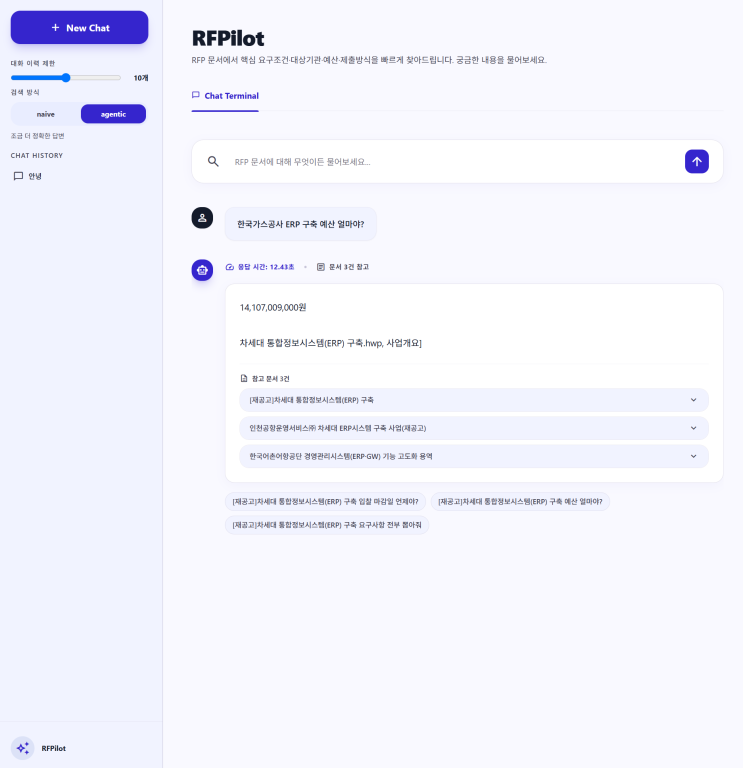
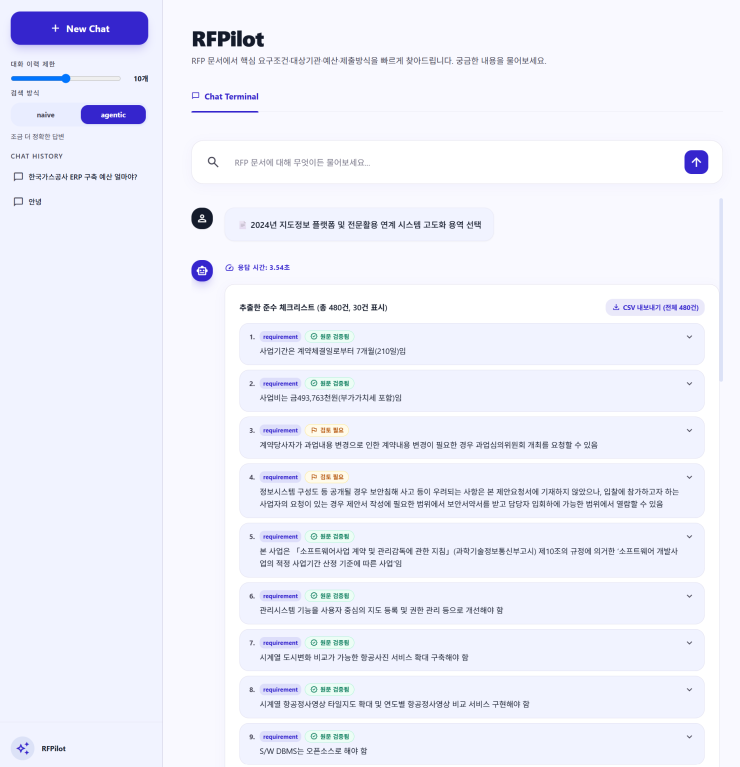

# 2026-Agentic-RAG-Project: RFP 문서 요약 & 질문/답변 챗봇

AI 엔지니어 10기 중급 팀 프로젝트 — 가상 B2G 입찰지원 스타트업 **'입찰메이트(RFPilot)'** 사내 RAG 시스템입니다. 
공공조달 RFP 문서(HWP 96 / PDF 4, 총 100건)에 대해 컨설턴트가 자연어로 질의하면, 검색·생성·의무항목 추출을 결합해 답변과 준수 체크리스트를 제공합니다.

> **기간**: 2026-06-17 ~ 07-08 (3주)
> **결과물**: 프로젝트 완료 보고서 + GitHub repo 제출

---

## 데모 (웹 챗봇 화면)

**조회 — 근거 문서·추천 질문과 함께 답변**



**체크리스트 — 항목별 신뢰 배지·인용 하이라이트·CSV**



---

## 프로젝트 개요 (수치)

### 데이터 규모
- RFP 문서: 100건 (HWP 96 / PDF 4)
- 청크: 14,606개 (chunks_v1)
- 골든셋(V5): 954 라벨 / 937 in_scope 채점 대상 (DE 아인 담당)

### 성능 지표
| 파트 | 지표 | 값 |
|------|------|-----|
| 라우트 C (의무항목 추출) | Item Coverage (V5, 8문서 전수) | 0.886 |
| 라우트 C | Item Precision | 0.286 |
| 라우트 C | Review Burden | 9.7% |
| 검색 (RAG) | Hit Rate @5 | 0.940 |
| 검색 (RAG) | MRR | 0.940 |
| 검색 (RAG) | Context Recall | 0.940 |
| 검색 (RAG) | Context Precision | 0.848 |
| 검색 (RAG) | 평균 응답 시간 | 207.7ms |
| 생성 | Faithfulness (golden 63, 비거부 50건) | 0.905 |
| 생성 | Answer Correctness | 0.608 |

라우트 C는 문서 단위 전수 채점(filter=none) 기준이며, 문서별 Coverage는 0.831~0.922로 안정적입니다.

---

## 팀 구성

| 이름 | 역할 | 담당 |
| --- | --- | --- |
| 민재 | PM (Project Manager) | 일정 관리, 이슈 조율, PR 리뷰 |
| 도혁 | DE (Data Engineer) | 문서 청킹 전략 설계 및 검증, 라우트 C 기능 구현 |
| 아인 | DE (Data Engineer) | 문서별 메타데이터 처리, 골든 데이터셋 구축 |
| 재헌 | RE (Retrieval Engineer) | 임베딩 생성, vector DB 구축, retrieval 기법 고도화 |
| 수민 | SD (Service Developer) | 모델 응답 고도화(정확도, 포맷, 길이, 톤 등), 챗봇 서비스 개발|

---

## 팀 보고서

> **보고서 제출 예정**
<a href="https://github.com/Codeit-Part3-5Team/codeit-part3-5team-project">바로 가기</a>

---

## 협업일지 및 팀 일간 보고서

<a href="https://github.com/orgs/Codeit-Part3-5Team/discussions">바로 가기</a>

---

## 프로젝트 파이프라인

실제 LangGraph 노드 흐름입니다.

```
[사용자 질문]
   │  ▼
질문 분석 (question_analysis)   대명사 해소·질문 재작성
   │  ▼
라우팅 (routing)   의도로 분기 (문서 선택 시 route_c 직행)
   │
   ├── route_a ── RFP 검색 (FAISS + bge-m3)
   │      ├─ naive   : 재검색 없이 바로 생성
   │      └─ agentic : grade → 부족 시 re_retrieve 재검색 루프
   │
   └── route_c ── 문서 선택 후 의무항목 추출
          ├─ 후보 문서 반환 → 사용자 선택
          └─ 선택 문서 체크리스트 생성 (캐시 우선)
   │  ▼
답변 생성 (answer_generation)   검색 근거로 답변 / 체크리스트 렌더
   │  ▼
검증 (self_check)   근거·거부 판정
   │  ▼
[최종 답변]
```

---

## 프로젝트 구조

```
codeit-part3-5team-project/
├── data/                 # 데이터 (.gitignore, NDA)
│   ├── raw/              # 원본 HWP, PDF
│   ├── metadata/         # data_list.csv
│   └── processed/        # 가공 데이터 (청크 JSON 등)
|
├── backend/    # FastAPI (웹/앱 공통)
|   |
│   ├── evaluation/   # 생성/검색 평가
|   |
│   ├── generation/   # 생성
│   │   └── prompts/  # 시스템 프롬프트
|   |
|   ├── graph/        # LangGraph
|   |   └── nodes/    # 노드
|   |
│   └── retrieval/    # 검색
|
├── data_processing/  # 데이터 전처리
|
├── evaluation/  # 데이터 평가
|
├── frontend/    # React 웹 프론트엔드
|
├── utils/       # 공통 유틸리티
|
├── notebooks/   # Jupyter Notebooks (baseline, experiments ...)
|
├── reports/     # 보고서·발표자료 PDF
└── .github/     # PR 템플릿, Issue 템플릿
```

---

## 환경 설정

### 사전 요구사항

- Python 3.12+

### 설치

```bash
git clone https://github.com/Codeit-Part3-5Team/codeit-part3-5team-project.git
cd codeit-part3-5team-project

# 가상환경 생성 (conda 권장)
conda create -n codeit-part3-5team-project python=3.12 -y
conda activate codeit-part3-5team-project

pip install -r requirements.txt
pip install -e .
```

`pip install -e .`는 개발 중인 현재 프로젝트를 Python 환경에 등록합니다.
노트북 또는 다른 작업 디렉터리에서 실행해도 `from backend...` import를 안정적으로 사용할 수 있습니다.

---

## 재현 방법

> 주의: 원본 RFP·골든셋·캐시 등 NDA 데이터는 리포에 포함되지 않습니다(.gitignore). 드라이브(Data Team)에서 별도 수령해 `data/` 하위에 배치한 뒤 실행하세요.

### 데이터 단독 실행

```bash
# 1) 원본 재파싱 (HWP/PDF 100건 → canonical 본문)
python data_processing/build_parsed_v2.py

# 2) PII 마스킹 적용 (parsed → masked_documents_v3.json)
#    v3 정책: 유선·대표번호 공개 / 개인 휴대폰·이메일·주민·사업자·법인 마스킹
PYTHONIOENCODING=utf-8 python data_processing/remask_v3.py

# 3) 청킹 (표 추출 v2 + tiktoken 기반, 입력=마스킹본)
python data_processing/build_chunks.py

# 4) 청크 품질 게이트 (중복/과세분화/PUA/토큰)
python evaluation/check_chunks.py

# 5) enriched 청크 생성 (청크 + doc_metadata → chunks_v1_0622_enriched.json)
#    이후 단계(마스킹 검증/매니페스트/골든셋)의 입력
python data_processing/enrich_chunks.py

# 6) PII 마스킹 검증 (3단계 누출 검사, PASS/FAIL 판정) — enriched 청크 필요
python evaluation/scan_3stage.py

# 7) 마스킹 매니페스트 생성 (검증 결과 증명) — enriched 청크 필요
python evaluation/build_manifest.py

# 8) 골든셋 빌드 (검색·생성 평가용) — enriched 청크 필요
python evaluation/build_golden_dataset_v3.py

# 9) V5 골든셋 무결성 검사 (하드 12축, 재청킹 시 깨짐 자동 감지)
python evaluation/verify_golden_v5.py

# 10) 라우트 C 의무항목 추출 채점 (V5 blind gold, 8문서 전수)
#    gold 관계: v5_gold_labels.json(SSOT) → make_v5_loader.py → v5_gold_questions.json
#    주의: gold는 NDA — 드라이브에서 수령하거나 로더로 생성 후 실행
#    V5 정식 채점 결과: macro Coverage 0.886 / Precision 0.286 / Review burden 9.7% (8문서 전수)
python make_v5_loader.py
python evaluation/run_v5_scoring.py --snapshot
#    스모크(단일 문서): python evaluation/run_v5_scoring.py --doc=DOC_061

# (참고) 데이터/추출기 단위 테스트
python -m pytest evaluation/test_masking.py -q          # 마스킹 회귀 14건
python evaluation/test_verify_evidence.py                # 근거 검증
python evaluation/test_dedupe.py                         # 중복 제거
python evaluation/test_sentinels.py                      # 센티넬
python evaluation/test_completeness_gate.py              # 완전성 게이트
python evaluation/test_compliance_extractor.py           # 추출기 통합
```

### 검색 단독 실행

```bash
# 디렉토리 이동
cd backend/retrieval

# 1) 청크 로드 확인 (data/processed/chunks_v1_enriched.json → LangChain Document)
python loader.py

# 2) bge-m3 임베딩 모델 로드 확인
python embedder_hf.py

# 3) bge-m3 FAISS 인덱스 빌드 (최초 1회 또는 청크 변경 시 → data/faiss_index_bge 생성)
python build_index_hf.py

# 4) FAISS_INDEX_PATH를 bge 인덱스로 지정 (최종 채택 구성)
export FAISS_INDEX_PATH=data/faiss_index_bge

# 5) retriever 단독 테스트 (메타필터 3단계 매칭 + MMR 검색)
python retriever.py

# 6) 전체 검색 파이프라인 실행 (rewrite → parse → retrieve → grade, LangGraph)
python rag_subgraph.py

# 7) (선택) 골든셋 기준 검색 성능 평가 — 최종 채택 구성(rewrite + meta filtering)
python eval_retrieval.py --golden golden_dataset_v4.json --rewrite --meta

```

### 생성 단독 실행

```bash
# 프로젝트 루트에서 실행 (backend는 python -m 으로 import)
# 1) 그래프 단독 확인 (rewrite → routing → route_a 검색 → 답변, LangGraph)
python -m backend.graph.build

# 2) 파이프라인 단독 테스트 (get_ai_response)
python -m backend.pipeline

# 3) (선택) 생성 평가 — 골든셋 답변 생성 후 RAGAS 채점
#    주의: OpenAI 호출로 비용 발생. 전체 실행 전 --limit로 소량 확인 권장.
python -m backend.evaluation.generate_answers --limit 5
python -m backend.evaluation.run_eval
```

### 챗봇 단독 실행

```bash
# 백엔드 (FastAPI, http://localhost:8000) — 프로젝트 루트에서
python -m backend.main

# 프론트엔드 (React, http://localhost:3000) — 별도 터미널
cd frontend
npm install
npm start
```

> 프론트엔드는 `.env`의 `REACT_APP_API_URL`(기본 `http://localhost:8000`)로 백엔드에 연결합니다.

---

## 데이터 배치 (드라이브 → 로컬)

NDA 데이터는 리포에 포함되지 않습니다(.gitignore). 드라이브(Data Team)에서 받아 아래 경로에 배치한 뒤 재현 명령어를 실행하세요.

| 드라이브 폴더 | 로컬 경로 | 용도 |
|--------------|-----------|------|
| 원본 데이터 | `data/raw/` | HWP/PDF 원본 100건 |
| 파싱본문 | `data/processed/` | canonical 본문 (parsed_documents_v2.json) |
| 마스킹본 | `data/processed/` | PII 마스킹 적용본 (masked_documents_v3.json) |
| 청크 | `data/processed/` | 청크 JSON (chunks_v1_0622_PASS.json) |
| doc_metadata | `data/processed/` | 문서 메타데이터 (enrich_chunks 입력) |
| enriched 청크 | `data/processed/` | 청크 + doc_metadata 조인 (chunks_v1_0622_enriched.json, 마스킹 검증·골든셋 입력) |(chunks_v1_0622_enriched.json, 마스킹 검증·골든셋 입력) |
| 골든셋 | `data/processed/` | 라벨 (v5_gold_labels.json 등) |
| 추출캐시 | `data/eval_cache/extractions/` | 문서별 추출 결과 |
| 평가결과 | `evaluation/reports/` | 채점 스냅샷 |
| faiss_index | `data/faiss_index_bge/` | 검색 인덱스 (검색팀) |

가공 산출물(파싱본/마스킹본/청크/골든셋)은 드라이브에 있으므로, 처음부터 재생성하지 않고 받아서 배치하면 바로 다음 단계를 실행할 수 있습니다.

---

## 실행 순서 (의존성)

```
파싱(build_parsed_v2)
   → 마스킹본(masked_documents_v3, 드라이브 수령)
      → 청킹(build_chunks) → 청크 게이트(check_chunks)
         → enriched 청크(드라이브 수령. 청크 + doc_metadata 조인)
            → 마스킹 검증(scan_3stage) / 매니페스트(build_manifest)  ← enriched 필요
            → 골든셋(build_golden_dataset_v3)  ← enriched 필요
               → 골든 무결성 게이트(verify_golden_v5)
                  → 라우트 C 채점(run_v5_scoring)  ← gold 필요
```

- 청킹(build_chunks)은 마스킹본(masked_documents_v3.json)을 입력으로 읽습니다. 드라이브에서 받아 `data/processed/`에 두면 됩니다.
- 마스킹 검증(scan_3stage)·매니페스트(build_manifest)는 3단계 검증의 마지막 스테이지로 enriched 청크를 입력으로 읽으므로, 청킹·enrich 이후에 실행해야 합니다.
- 골든셋 빌드도 enriched 청크를 입력으로 사용합니다.
- 라우트 C 채점은 청크 + gold가 필요합니다. gold 관계: v5_gold_labels.json(SSOT) → `make_v5_loader.py` → v5_gold_questions.json.

---

## API 키 / 비용 주의

- 일부 스크립트는 OpenAI API 사용합니다: `run_v5_scoring.py`(matcher), `build_golden_dataset_v3.py`(평가), 추출기.
- 실행 전 `.env`에 `OPENAI_API_KEY`가 필요합니다(BOM 없이 UTF-8, gitignore 대상).
- 팀 공용 한도($20)를 공유합니다. 대규모 채점·재추출은 잔여 예산을 확인하고 실행하세요.
- 캐시가 있으면 재호출이 0입니다. 불필요한 `--force` 재추출은 피하세요(8문서 전체 재추출 약 $2.6).

---

## API 유료 사용 정책

<a href="https://github.com/orgs/Codeit-Part3-5Team/discussions/121">바로 가기</a>

---

## 트러블슈팅

| 담당 | 증상 | 원인 | 해결 |
|------|------|------|------|
| 데이터 | 한글 파일이 깨진 채 저장됨 | PowerShell Get-Content/Set-Content가 CP949로 처리 | Python io.open(encoding="utf-8")로 읽고 쓰기 |
| 데이터 | 콘솔에서 한글·기호가 깨져 보임 | 콘솔 출력 인코딩이 CP949 | PYTHONIOENCODING=utf-8 설정 후 실행 |
| 데이터| build_chunks 실행 시 입력 파일 없음 | 마스킹본이 data/processed/에 없음 | 드라이브에서 masked_documents_v3.json 수령 후 배치 |
| 데이터| scan_3stage/build_manifest/골든셋 빌드 에러 | enriched 청크가 data/processed/에 없음 | 드라이브에서 enriched 청크 수령 후 배치 (청킹 이후 단계) |
| 데이터| run_v5_scoring.py 실행 시 파일 없음 에러 | gold(v5_gold_questions.json)가 없음 | make_v5_loader.py로 생성하거나 드라이브 수령 |
| 데이터| 채점이 예상보다 느리고 비용이 큼 | 캐시 미스로 matcher 신규 호출 | 캐시 배치 확인. 캐시 히트 시 재호출 0 |
| 검색 | followup 질문("그럼 이 사업은...") 검색 완전 실패 (HR@5 0.0~0.2) | history 없이 지시어 그대로 벡터 검색에 투입 → retriever가 지시어를 해소 못함 | query_rewriter.py로 질문을 독립 문장으로 재작성 후 검색 (HR@5 1.000으로 개선) |
| 검색 | single_doc 질문의 15%가 정답 청크 5위 밖으로 밀림 | 사업명·기관명 표기 변형(줄임말 등)을 벡터 유사도만으로 처리 못함 | agency 메타 필터 3단계 매칭(exact→별칭사전→rapidfuzz) 적용, _resolve_agency |
| 검색 | agency + project_name 동시 필터링 시 오히려 성능 하락 | project_name은 fallback 없는 단순 substring 매칭이라, 파서가 사업명을 잘못 추출하면 AND 조건으로 정답 청크까지 걸러짐 | project_name 필터 빼고 agency만 필터링(agency-only)으로 최종 채택 |
| 검색 | agency 필터 매칭 실패/0건 시 검색 결과 자체가 0개로 실패 | 기관명 매핑 안 되면 그대로 빈 결과 반환 | re_retrieve_fn으로 agency 필터 자동 스킵 후 재검색(fallback) 추가 |
| 검색 | Reranking(ms-marco, bge-reranker-large) 적용 시 오히려 MRR 하락 | ms-marco는 영어 데이터셋 학습 모델이라 한국어 공공조달 도메인 판별력 없음 / bge-reranker-large도 범용이라 FAISS 임베딩 순위를 오히려 역전시킴 | reranking 최종 미채택. 한국어 특화 cross-encoder 재검토는 향후 과제로 남김 |
| 검색 | rerank_top_n=20에서는 21위 밖 정답 문서를 rerank가 아예 못 봄, top_n=100으로 늘리면 레이턴시 10배(4.8s→44.8s) 증가 + 성능도 저하 | rerank 후보 범위와 레이턴시가 트레이드오프 관계 | 범위 확대·축소 둘 다 실패 → reranking 자체를 파이프라인에서 제외 |
| 검색 | Multi-query RRF 적용 후 multi_doc Context Precision 대폭 하락(0.688→0.560) | MMR 결과에 score 메타데이터가 없어 RRF 정렬이 사실상 무의미 / 중복 제거 시 후보가 오히려 줄어듦 / 무관 문서가 복수 쿼리에서 중복 노출돼 상위권 진입 | multi-query 최종 드롭. RRF 대신 메타데이터 직접 쿼리 방식 검토를 향후 과제로 남김 |
| 검색 | 임베딩 모델 교체(OpenAI text-embedding-3-small → bge-m3) 시 기존 FAISS 인덱스로 검색하면 깨짐 |인덱스는 임베딩 모델(차원·벡터 공간)에 종속적이라 다른 모델의 벡터와 혼용 불가 | build_index_hf.py로 별도 인덱스(data/faiss_index_bge) 새로 빌드, 기존 인덱스와 분리 관리 |
| 생성 | 프론트에서 "서버 연결 실패" 표시 | 백엔드(:8000) 미기동 또는 API 주소 불일치 | `python -m backend.main` 기동 확인 + 프론트 `REACT_APP_API_URL` 점검 |
| 생성 | `python backend/pipeline.py` 실행 시 `ModuleNotFoundError: backend` | 하위 폴더에서 실행 | 프로젝트 루트에서 `python -m backend.pipeline` 형식으로 실행 |
| 생성 | 라우트 C 체크리스트가 문서당 수 분 소요 | 캐시 미스로 라이브 추출 | `data/eval_cache/extractions/`에 추출 캐시 배치(히트 시 즉시) |

---

## 데이터 처리 정책

<a href="https://github.com/orgs/Codeit-Part3-5Team/discussions/152">바로 가기</a>

---

## 라이선스

본 프로젝트는 [gpt-5-mini](https://developers.openai.com/api/docs/models/gpt-5-mini) OpenAI API 사용합니다.

---
