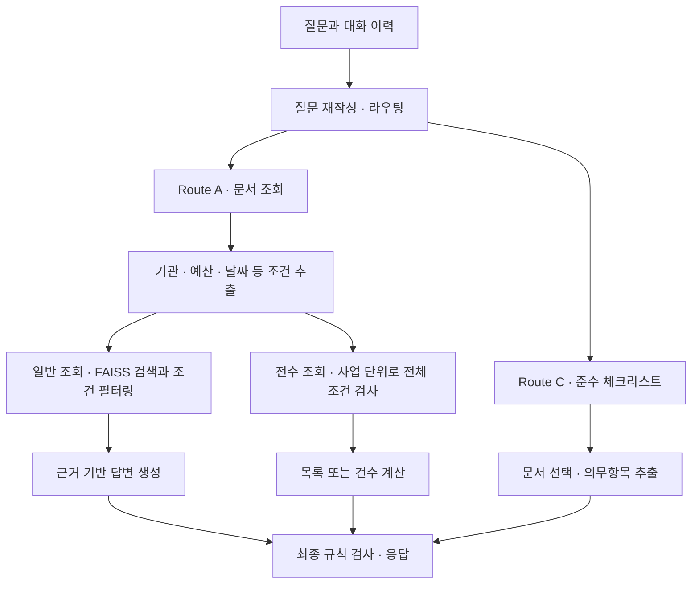

# RFPilot · 공공조달 RFP 챗봇 개인 고도화

코드잇 AI 엔지니어 10기 5팀에서 만든 공공조달 RFP 챗봇 <strong>입찰메이트(RFPilot)</strong>를 개인적으로 고도화한 저장소입니다. 팀 프로젝트를 마친 뒤 검색 평가 코드와 실제 챗봇의 요청 경로를 다시 따라가며, 검색 조건이 답변에 반영되는 방식과 전체 목록을 조회하는 방식을 개선했습니다.

## 팀 프로젝트에서 만든 것

팀은 공공조달 제안요청서 100건(HWP 96건, PDF 4건)을 대상으로 문서 조회·요약, 근거 인용, 준수 체크리스트 기능을 구현했습니다. 문서를 전처리해 BGE-M3와 FAISS로 검색하고, LangGraph가 질문 유형에 따라 조회와 체크리스트 경로를 선택합니다. FastAPI와 React로 챗봇을 연결했습니다.

팀에서 저는 <strong>검색 담당(Retrieval Engineer)</strong>으로 임베딩 생성, 벡터 인덱스 구축, 검색 기법 개선과 평가를 맡았습니다. 팀원별 역할과 당시 성능 지표는 팀 저장소와 완료 보고서에 정리되어 있습니다. [원본 팀 저장소](https://github.com/Codeit-Part3-5Team/codeit-part3-5team-project) · [팀 프로젝트 완료 보고서](https://codeit-part3-5team.github.io/codeit-part3-5team-project/reports/RFP_프로젝트_완료_보고서_5팀.pdf)

## 검토에서 발견한 문제와 개인 고도화

### 1. 검색 평가에서 사용한 메타데이터 필터를 챗봇에 연결

검색 단독 평가에서는 질문에서 발주기관·예산·날짜를 추출해 검색 함수에 전달했습니다. 챗봇의 첫 검색은 재작성된 질문과 `top_k`만 전달하고 있어, 평가에서 사용한 조건이 답변 근거를 고르는 과정에 빠져 있었습니다.

기존 조건 추출기를 Route A에 연결해 기관·예산·날짜 조건과 정렬을 첫 검색에 적용했습니다. 재검색에서도 조건을 유지하도록 하고, 생성 모델에는 그 조건을 통과한 청크를 전달하도록 했습니다. [Route A](backend/graph/nodes/route_a.py) · [조건 추출기](backend/retrieval/query_parser.py) · [재검색 노드](backend/graph/nodes/re_retrieve.py)

전수 조회를 추가하기 전에 RFP 문서 100건에서 추출한 사업 정보 요약과 골든셋 v4의 질문 6개로, 같은 챗봇 경로에서 필터 적용 전후를 비교했습니다. 이 실험에서는 OpenAI를 사용해 조건 추출과 답변 생성까지 실행했습니다.

| 지표 | 필터 끔 | 필터 켬 |
| --- | ---: | ---: |
| 정답 문서가 검색 1위에 나온 문항 | 3/6 | 6/6 |
| 정답 문서 회수율 평균 (상위 5건) | 50.0% | 87.1% |
| 평균 전체 응답시간 | 7.90초 | 10.44초 |

최대 예산과 최초 공개일 질문은 최종 답변도 오답에서 정답으로 바뀌었습니다. 응답시간은 평균 2.54초 늘었습니다. 위 수치는 사업 정보 요약 인덱스와 질문 6개를 사용한 소규모 비교 결과입니다.

### 2. 사업 목록과 건수를 전체 인덱스에서 조회

첫 번째 실험에서 “예산 5억 원 이상인 사업을 모두 알려줘”는 조건에 맞는 사업을 22건 찾았지만, `top_k=5` 제한으로 답변에는 5건만 들어갔습니다. 목록이나 건수를 묻는 질문은 검색 상위권 밖의 사업도 확인해야 했습니다.

전수 조회 경로에서는 인덱스의 문서를 `doc_id`로 묶고, 사업별 대표 메타데이터에 조건을 적용합니다. 코드가 일치한 사업을 모두 나열하거나 건수를 계산합니다. 조건 판단에 필요한 값이 비어 있는 경우는 별도로 표시합니다. [전수 조회 구현](backend/retrieval/catalog.py)

초기에는 사업 정보 요약 100건과 고정된 조건 추출 응답으로 조회 로직을 검증했습니다. 이후 **전체 14,606개 청크·사업 100건으로 FAISS를 생성**하고, 실제 LLM 조건 추출과 `/chat`을 연결해 전수 조회를 종단간 평가했습니다.

전체 인덱스의 첫 평가에서는 24문항 중 17문항이 통과했습니다. 실패 문항을 검토하고 재평가를 반복하며, 지원 여부 오분류·초과와 미만의 경계 처리 오류·API 타임아웃을 단계적으로 개선했습니다.

- **조회 범위를 코드에서 결정**. LLM은 기관·예산·날짜·정렬 조건과 지원할 수 없는 조건을 추출합니다. 코드가 이를 검증해 전체 조회·조건 조회·지원 불가를 결정합니다.
- **금액과 비교 연산을 분리**. LLM은 원 단위 금액과 이상·초과·이하·미만·같음을 추출합니다. 초과의 +1원, 미만의 -1원 경계 변환과 복수 조건의 교집합은 코드가 계산합니다.
- **응답 형식과 미지원 조건 검증**. JSON 스키마로 출력 형식을 지정하고 범위·날짜·정렬을 검증합니다. 기준일 없는 상대 날짜는 호출 전에 차단합니다.
- **조건 추출 지연 개선**. 같은 `gpt-5-nano`의 추론량을 `minimal`로 설정하고, 조건 없는 전체 목록·건수 조회의 지원 여부를 프롬프트에 명시했습니다. [조건 추출기](backend/retrieval/query_parser.py)

### 전수 조회 E2E 평가 결과

전체 청크 인덱스와 동일한 회귀 질문 24개를 사용해 실제 조건 추출부터 조회 유형 판정·사업별 조건 검사·최종 응답까지 평가했습니다. 예산·기관·날짜·복합 조건, 정렬, 목록·건수, 결과 0건과 미지원 조건을 포함합니다. 전수 조회의 목록·건수 응답은 코드가 구성합니다.

| 지표 | 조건 추출기 개선 전 | 최종 수정 후 |
| --- | ---: | ---: |
| 종단간 성공 | 17/24 (70.8%) | **24/24 (100%)** |
| 지원 조건 질문 성공 | 15/21 (71.4%) | 21/21 (100%) |
| 미지원 조건 질문 성공 | 2/3 (66.7%) | 3/3 (100%) |
| 평균 요청 처리 시간 | 6.726초 | **1.281초** |
| API 타임아웃 | 2/24 | **0/24** |

예산 5억 원 이상인 사업은 정답 **22건 전부**를 반환하고 예산 미확인 7건을 별도로 안내했습니다. 초과·미만 질문에서도 정확히 5억 원인 사업을 제외해 각각 정답 21건·71건을 반환했습니다.

평균 시간은 인덱스·모델 사전 로딩을 제외하며 실패 요청도 포함합니다. 위 수치는 수정 과정에서 사용한 동일한 회귀 질문 24개를 각 버전에서 한 번씩 실행한 결과입니다. 독립된 질문 세트와 반복 실행의 검증은 추가로 필요합니다. 일반 검색·답변 생성과 다중 대화 경로는 이번 전수 조회 평가의 범위에 포함되지 않습니다. [평가 조건·실패 분석·단계별 결과](reports/catalog-e2e-evaluation.md)

## 개인 고도화 데모

가상 사업 10건을 사용한 로컬 React 화면입니다. 조건 추출과 일반 조회의 생성 응답은 데모용으로 구성했고, 검색 필터와 전수 조회는 실제 챗봇 코드로 실행했습니다.

### 일반 조회 · 메타데이터 필터 적용

미래데이터원이 발주한 예산 5억 원 이상 사업 중 하나를 답변합니다. 참고 문서에는 기관과 예산 조건을 모두 충족한 2건이 표시됩니다.


### 전수 조회 · 일치하는 사업 전체 반환

예산 5억 원 이상인 사업을 예산 내림차순으로 조회합니다. 조건에 맞는 7건을 모두 나열하고, 예산 정보가 없어 판정할 수 없는 1건은 따로 안내합니다.


## 현재 파이프라인



일반 조회는 Naive 모드에서 검색 후 생성으로 넘어가고, Agentic 모드에서는 검색 결과를 평가하고 필요할 때 재검색합니다.

---

## 프로젝트 구조

```
rfp-rag-e2e/
├── data/                 # 데이터 (.gitignore, NDA)
│   ├── raw/              # 원본 HWP, PDF
│   ├── metadata/         # data_list.csv
│   └── processed/        # 가공 데이터 (청크 JSON 등)
|
├── backend/    # FastAPI (웹/앱 공통)
|   |
│   ├── evaluation/   # 생성/검색 평가
|   |
│   ├── generation/   # 생성
│   │   └── prompts/  # 시스템 프롬프트
|   |
|   ├── graph/        # LangGraph
|   |   └── nodes/    # 노드
|   |
│   └── retrieval/    # 검색
|
├── data_processing/  # 데이터 전처리
|
├── evaluation/  # 데이터 평가
|
├── frontend/    # React 웹 프론트엔드
|
├── utils/       # 공통 유틸리티
|
├── notebooks/   # Jupyter Notebooks (baseline, experiments ...)
|
├── reports/     # 보고서·발표자료 PDF
└── .github/     # PR 템플릿, Issue 템플릿
```

---

## 환경 설정

### 사전 요구사항

- Python 3.12+

### 설치

```bash
git clone https://github.com/kimzaeheon-data/rfp-rag-e2e.git
cd rfp-rag-e2e

# 가상환경 생성 (conda 권장)
conda create -n rfp-rag-e2e python=3.12 -y
conda activate rfp-rag-e2e

pip install -r requirements.txt
```

백엔드와 평가 모듈은 저장소 루트에서 `python -m backend...` 형식으로 실행합니다. 임베딩 실행 환경에는 `langchain-huggingface`와 `sentence-transformers`도 필요합니다.

```bash
pip install langchain-huggingface sentence-transformers
```

로컬 `.env`에 개인 API 키와 데이터 경로를 설정합니다.

```dotenv
OPENAI_API_KEY=your_personal_api_key
CHUNKS_PATH=data/processed/chunks_v1_0622_enriched.json
FAISS_INDEX_PATH=data/faiss_index_bge_full
```

전체 청크 FAISS의 `index.faiss`와 `index.pkl`을 `data/faiss_index_bge_full/`에 함께 배치합니다. 이번 평가에 사용한 인덱스는 BGE-M3·1024차원이며, 벡터를 정규화해 생성했습니다.

로컬 macOS 검증 중 확인된 FAISS·PyTorch의 OpenMP 중복 로딩 오류는 프로젝트 전용 가상환경에서 두 패키지가 같은 런타임을 참조하도록 조정했습니다. [OpenMP 충돌 진단과 해결 방법](https://docs.haystack.deepset.ai/docs/faissdocumentstore#fixing-openmp-runtime-conflicts-on-macos)

---

## 재현 방법

> 주의: 원본 RFP·골든셋·캐시 등 NDA 데이터는 리포에 포함되지 않습니다(.gitignore). 드라이브(Data Team)에서 별도 수령해 `data/` 하위에 배치한 뒤 실행하세요.

### 전수 조회 E2E 평가

실행기가 FastAPI `/chat`과 실제 LLM 조건 추출을 호출합니다. 전체 청크와 인덱스를 배치하고 `.env`를 설정한 뒤 프로젝트 루트에서 실행합니다.

```bash
python -m backend.evaluation.evaluate_catalog \
  --chunks data/processed/chunks_v1_0622_enriched.json \
  --index data/faiss_index_bge_full \
  --tag full_index_new_run
```

질문별 응답·조건 추출 결과·채점과 실행 파일 해시는 `data/eval_results/catalog_e2e_full_index_new_run.json`에 저장됩니다. 재실행할 때는 새로운 `--tag`를 사용합니다. `--prepare-only`를 추가하면 API 호출 없이 원본 사업 정보의 일관성과 정답 목록을 검사합니다. 기존 골든셋 v4가 있으면 `--golden <golden_dataset_v4.json 경로>`로 예산 조건 3개의 정답 ID도 교차 확인할 수 있습니다.

조건 추출기의 오프라인 회귀 테스트는 다음 명령으로 실행합니다.

```bash
python -m unittest discover -s evaluation -p test_query_parser.py -v
```

### 데이터 단독 실행

```bash
# 1) 원본 재파싱 (HWP/PDF 100건 → canonical 본문)
python data_processing/build_parsed_v2.py

# 2) PII 마스킹 적용 (parsed → masked_documents_v3.json)
#    v3 정책: 유선·대표번호 공개 / 개인 휴대폰·이메일·주민·사업자·법인 마스킹
PYTHONIOENCODING=utf-8 python data_processing/remask_v3.py

# 3) 청킹 (표 추출 v2 + tiktoken 기반, 입력=마스킹본)
python data_processing/build_chunks.py

# 4) 청크 품질 게이트 (중복/과세분화/PUA/토큰)
python evaluation/check_chunks.py

# 5) enriched 청크 생성 (청크 + doc_metadata → chunks_v1_0622_enriched.json)
#    이후 단계(마스킹 검증/매니페스트/골든셋)의 입력
python data_processing/enrich_chunks.py

# 6) PII 마스킹 검증 (3단계 누출 검사, PASS/FAIL 판정) — enriched 청크 필요
python evaluation/scan_3stage.py

# 7) 마스킹 매니페스트 생성 (검증 결과 증명) — enriched 청크 필요
python evaluation/build_manifest.py

# 8) 골든셋 빌드 (검색·생성 평가용) — enriched 청크 필요
python evaluation/build_golden_dataset_v3.py

# 9) V5 골든셋 무결성 검사 (하드 12축, 재청킹 시 깨짐 자동 감지)
python evaluation/verify_golden_v5.py

# 10) 라우트 C 의무항목 추출 채점 (V5 blind gold, 8문서 전수)
#    gold 관계: v5_gold_labels.json(SSOT) → make_v5_loader.py → v5_gold_questions.json
#    주의: gold는 NDA — 드라이브에서 수령하거나 로더로 생성 후 실행
#    V5 정식 채점 결과: macro Coverage 0.886 / Precision 0.286 / Review burden 9.7% (8문서 전수)
python make_v5_loader.py
python evaluation/run_v5_scoring.py --snapshot
#    스모크(단일 문서): python evaluation/run_v5_scoring.py --doc=DOC_061

# (참고) 데이터/추출기 단위 테스트
python -m pytest evaluation/test_masking.py -q          # 마스킹 회귀 14건
python evaluation/test_verify_evidence.py                # 근거 검증
python evaluation/test_dedupe.py                         # 중복 제거
python evaluation/test_sentinels.py                      # 센티넬
python evaluation/test_completeness_gate.py              # 완전성 게이트
python evaluation/test_compliance_extractor.py           # 추출기 통합
```

### 검색 단독 실행

프로젝트 루트에서 실행합니다. `.env`에 설정한 전체 청크 인덱스를 사용합니다.

```bash
# 전체 청크 로드 확인
python -m backend.retrieval.loader data/processed/chunks_v1_0622_enriched.json

# BGE-M3 임베딩 모델 로드 확인
python -m backend.retrieval.embedder_hf

# 인덱스 로드와 메타데이터 필터 검색 확인
PYTHONPATH=backend/retrieval python backend/retrieval/retriever.py
```

### 생성 단독 실행

```bash
# 프로젝트 루트에서 실행 (backend는 python -m 으로 import)
# 1) 그래프 단독 확인 (rewrite → routing → route_a 검색 → 답변, LangGraph)
python -m backend.graph.build

# 2) 파이프라인 단독 테스트 (get_ai_response)
python -m backend.pipeline

# 3) (선택) 생성 평가 — 골든셋 답변 생성 후 RAGAS 채점
#    주의: OpenAI 호출로 비용 발생. 전체 실행 전 --limit로 소량 확인 권장.
python -m backend.evaluation.generate_answers --limit 5
python -m backend.evaluation.run_eval
```

일반 조회(Route A)는 기관·예산·날짜·정렬 조건을 첫 검색과 재검색에 적용합니다.

“예산 5억 원 이상인 사업을 모두 알려줘”처럼 사업 목록이나 건수를 요청하면, 인덱스에 등록된 사업을 문서 ID로 중복 제거하고 전체를 조회합니다. 발주기관, 예산 범위, 공개일·입찰일 범위를 지원하며, 필수 메타데이터가 없어 판정할 수 없는 건수는 별도로 표시합니다. 목록과 건수는 조회 결과로 직접 만들고, 일반 질의의 `top_k` 제한은 적용하지 않습니다.

현재 챗봇의 기본 경로와 조건 추출·전수 조회를 끈 경로를 비교하려면 같은 골든셋과 설정으로 아래 두 명령을 실행합니다. 각 결과에는 답변과 검색 근거가 함께 저장됩니다.

```bash
python -m backend.evaluation.generate_answers --limit 5 --no-query-metadata --tag metadata_ab
python -m backend.evaluation.generate_answers --limit 5 --tag metadata_ab
```

### 챗봇 단독 실행

```bash
# 백엔드 (FastAPI, http://localhost:8000) — 프로젝트 루트에서
python -m backend.main

# 프론트엔드 (React, http://localhost:3000) — 별도 터미널
cd frontend
npm install
npm start
```

> 프론트엔드는 `.env`의 `REACT_APP_API_URL`(기본 `http://localhost:8000`)로 백엔드에 연결합니다.

---

## 데이터 배치 (드라이브 → 로컬)

NDA 데이터는 리포에 포함되지 않습니다(.gitignore). 드라이브(Data Team)에서 받아 아래 경로에 배치한 뒤 재현 명령어를 실행하세요.

| 드라이브 폴더 | 로컬 경로 | 용도 |
|--------------|-----------|------|
| 원본 데이터 | `data/raw/` | HWP/PDF 원본 100건 |
| 파싱본문 | `data/processed/` | canonical 본문 (parsed_documents_v2.json) |
| 마스킹본 | `data/processed/` | PII 마스킹 적용본 (masked_documents_v3.json) |
| 청크 | `data/processed/` | 청크 JSON (chunks_v1_0622_PASS.json) |
| doc_metadata | `data/processed/` | 문서 메타데이터 (enrich_chunks 입력) |
| enriched 청크 | `data/processed/` | 청크 + doc_metadata 조인 (chunks_v1_0622_enriched.json, 마스킹 검증·골든셋 입력) |
| 골든셋 | `data/processed/` | 라벨 (v5_gold_labels.json 등) |
| 추출캐시 | `data/eval_cache/extractions/` | 문서별 추출 결과 |
| 평가결과 | `evaluation/reports/` | 채점 스냅샷 |
| 전체 청크 FAISS | `data/faiss_index_bge_full/` | BGE-M3 검색 인덱스 (`index.faiss`·`index.pkl`, 14,606개 벡터) |

가공 산출물(파싱본/마스킹본/청크/골든셋)은 드라이브에 있으므로, 처음부터 재생성하지 않고 받아서 배치하면 바로 다음 단계를 실행할 수 있습니다.

---

## 실행 순서 (의존성)

```
파싱(build_parsed_v2)
   → 마스킹본(masked_documents_v3, 드라이브 수령)
      → 청킹(build_chunks) → 청크 게이트(check_chunks)
         → enriched 청크(드라이브 수령. 청크 + doc_metadata 조인)
            → 마스킹 검증(scan_3stage) / 매니페스트(build_manifest)  ← enriched 필요
            → 골든셋(build_golden_dataset_v3)  ← enriched 필요
               → 골든 무결성 게이트(verify_golden_v5)
                  → 라우트 C 채점(run_v5_scoring)  ← gold 필요
```

- 청킹(build_chunks)은 마스킹본(masked_documents_v3.json)을 입력으로 읽습니다. 드라이브에서 받아 `data/processed/`에 두면 됩니다.
- 마스킹 검증(scan_3stage)·매니페스트(build_manifest)는 3단계 검증의 마지막 스테이지로 enriched 청크를 입력으로 읽으므로, 청킹·enrich 이후에 실행해야 합니다.
- 골든셋 빌드도 enriched 청크를 입력으로 사용합니다.
- 라우트 C 채점은 청크 + gold가 필요합니다. gold 관계: v5_gold_labels.json(SSOT) → `make_v5_loader.py` → v5_gold_questions.json.

---

## API 키와 평가 데이터

개인 고도화와 평가에는 `.env`의 개인 `OPENAI_API_KEY`를 사용합니다. 실제 API 평가에는 호출 비용이 발생합니다. 전수 조회 E2E 실행기는 질문별 실제 조건 추출을 수행하며, `--prepare-only`는 정답 준비만 수행합니다.

API 키, 원본 청크, FAISS와 사업 정보가 포함된 상세 결과는 Git에서 제외됩니다. 공개 평가 요약은 `reports/catalog-e2e-evaluation.md`에 기록합니다.

팀 프로젝트 당시의 API 사용 기준은 원본 팀 논의에 남아 있습니다. [팀 프로젝트 당시 API 사용 기준](https://github.com/orgs/Codeit-Part3-5Team/discussions/121)

---

## 트러블슈팅

| 담당 | 증상 | 원인 | 해결 |
|------|------|------|------|
| 데이터 | 한글 파일이 깨진 채 저장됨 | PowerShell Get-Content/Set-Content가 CP949로 처리 | Python io.open(encoding="utf-8")로 읽고 쓰기 |
| 데이터 | 콘솔에서 한글·기호가 깨져 보임 | 콘솔 출력 인코딩이 CP949 | PYTHONIOENCODING=utf-8 설정 후 실행 |
| 데이터| build_chunks 실행 시 입력 파일 없음 | 마스킹본이 data/processed/에 없음 | 드라이브에서 masked_documents_v3.json 수령 후 배치 |
| 데이터| scan_3stage/build_manifest/골든셋 빌드 에러 | enriched 청크가 data/processed/에 없음 | 드라이브에서 enriched 청크 수령 후 배치 (청킹 이후 단계) |
| 데이터| run_v5_scoring.py 실행 시 파일 없음 에러 | gold(v5_gold_questions.json)가 없음 | make_v5_loader.py로 생성하거나 드라이브 수령 |
| 데이터| 채점이 예상보다 느리고 비용이 큼 | 캐시 미스로 matcher 신규 호출 | 캐시 배치 확인. 캐시 히트 시 재호출 0 |
| 검색 | followup 질문("그럼 이 사업은...") 검색 완전 실패 (HR@5 0.0~0.2) | history 없이 지시어 그대로 벡터 검색에 투입 → retriever가 지시어를 해소 못함 | query_rewriter.py로 질문을 독립 문장으로 재작성 후 검색 (HR@5 1.000으로 개선) |
| 검색 | single_doc 질문의 15%가 정답 청크 5위 밖으로 밀림 | 사업명·기관명 표기 변형(줄임말 등)을 벡터 유사도만으로 처리 못함 | agency 메타 필터 3단계 매칭(exact→별칭사전→rapidfuzz) 적용, _resolve_agency |
| 검색 | agency + project_name 동시 필터링 시 오히려 성능 하락 | project_name은 fallback 없는 단순 substring 매칭이라, 파서가 사업명을 잘못 추출하면 AND 조건으로 정답 청크까지 걸러짐 | project_name 필터 빼고 agency만 필터링(agency-only)으로 최종 채택 |
| 검색 | agency 필터 매칭 실패/0건 시 검색 결과 자체가 0개로 실패 | 기관명 매핑 안 되면 그대로 빈 결과 반환 | re_retrieve_fn으로 agency 필터 자동 스킵 후 재검색(fallback) 추가 |
| 검색 | Reranking(ms-marco, bge-reranker-large) 적용 시 오히려 MRR 하락 | ms-marco는 영어 데이터셋 학습 모델이라 한국어 공공조달 도메인 판별력 없음 / bge-reranker-large도 범용이라 FAISS 임베딩 순위를 오히려 역전시킴 | reranking 최종 미채택. 한국어 특화 cross-encoder 재검토는 향후 과제로 남김 |
| 검색 | rerank_top_n=20에서는 21위 밖 정답 문서를 rerank가 아예 못 봄, top_n=100으로 늘리면 레이턴시 10배(4.8s→44.8s) 증가 + 성능도 저하 | rerank 후보 범위와 레이턴시가 트레이드오프 관계 | 범위 확대·축소 둘 다 실패 → reranking 자체를 파이프라인에서 제외 |
| 검색 | Multi-query RRF 적용 후 multi_doc Context Precision 대폭 하락(0.688→0.560) | MMR 결과에 score 메타데이터가 없어 RRF 정렬이 사실상 무의미 / 중복 제거 시 후보가 오히려 줄어듦 / 무관 문서가 복수 쿼리에서 중복 노출돼 상위권 진입 | multi-query 최종 드롭. RRF 대신 메타데이터 직접 쿼리 방식 검토를 향후 과제로 남김 |
| 검색 | 임베딩 모델 교체(OpenAI text-embedding-3-small → bge-m3) 시 기존 FAISS 인덱스로 검색하면 깨짐 |인덱스는 임베딩 모델(차원·벡터 공간)에 종속적이라 다른 모델의 벡터와 혼용 불가 | 같은 임베딩 모델과 정규화 설정으로 인덱스를 생성하고 `FAISS_INDEX_PATH`를 해당 경로로 지정 |
| 생성 | 프론트에서 "서버 연결 실패" 표시 | 백엔드(:8000) 미기동 또는 API 주소 불일치 | `python -m backend.main` 기동 확인 + 프론트 `REACT_APP_API_URL` 점검 |
| 생성 | `python backend/pipeline.py` 실행 시 `ModuleNotFoundError: backend` | 하위 폴더에서 실행 | 프로젝트 루트에서 `python -m backend.pipeline` 형식으로 실행 |
| 생성 | 라우트 C 체크리스트가 문서당 수 분 소요 | 캐시 미스로 라이브 추출 | `data/eval_cache/extractions/`에 추출 캐시 배치(히트 시 즉시) |

---

## 데이터 처리 정책

<a href="https://github.com/orgs/Codeit-Part3-5Team/discussions/152">바로 가기</a>

---

## 라이선스

본 프로젝트는 [gpt-5-mini](https://developers.openai.com/api/docs/models/gpt-5-mini) OpenAI API 사용합니다.

---
